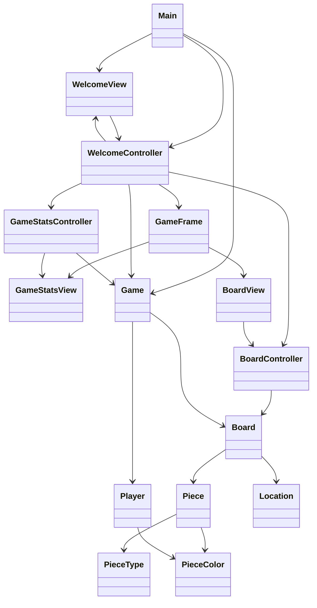

# US-01 Design: Start a New Game

This is the design for [US-01](../requirements/game-setup.md) only. A later story will add its own classes and methods when that story is the feature being built. 

Here is the shape of the design:

1. Sketch the screens.
2. Split those screens into views. Each view has one controller.
3. Put the game rules and the game data in model classes.
4. A model may be used by more than one controller. A view does not call a model. The view reports a user action to its controller, and the controller calls the model.

Fields are private. Nothing gets a setter unless a later story has a reason for one. A class exposes what it can do. `Location` and `Player` are data classes: they hold values and do not act on them. `PieceType` and `PieceColor` are enums.

## UI sketch

Startup shows the welcome screen. Start Game stays on this screen when a name is missing, and shows the error under the button.

```text
+--------------------------------------+
|          Welcome to Chess           |
|                                      |
|   Player 1 name   [______________]   |
|   Player 2 name   [______________]   |
|                                      |
|            [ Start Game ]            |
|                                      |
|   Both player names are required.    |
+--------------------------------------+
```

A valid start closes that window and opens the game window. White is at the bottom. The lower-right square, h1, is light. The pieces are in the starting position. Nothing on this window moves a piece yet.

```text
+--------------------------------------+
|  Player 1: Ada (White)               |
|  Player 2: Bo (Black)                |
|  Current player: Ada                 |
+--------------------------------------+
|     a  b  c  d  e  f  g  h           |
|  8  r  n  b  q  k  b  n  r           |
|  7  p  p  p  p  p  p  p  p           |
|  6  .  .  .  .  .  .  .  .           |
|  5  .  .  .  .  .  .  .  .           |
|  4  .  .  .  .  .  .  .  .           |
|  3  .  .  .  .  .  .  .  .           |
|  2  P  P  P  P  P  P  P  P           |
|  1  R  N  B  Q  K  B  N  R           |
+--------------------------------------+
```

## Views and controllers

| View | Controller | What the user sees | User action in US-01 |
| --- | --- | --- | --- |
| `WelcomeView` | `WelcomeController` | Two name fields, Start Game, and an error line | Click Start Game |
| `GameStatsView` | `GameStatsController` | Both names, both colors, and whose turn it is | None |
| `BoardView` | `BoardController` | The 8×8 board and the 32 pieces | None |

`GameFrame` is the window that holds `GameStatsView` and `BoardView`. It does not react to input and it does not read the model, so it has no controller. `Main` only starts the application.

## Flow of events

Application start:

1. `Main` creates a `Game`, a `WelcomeController` for that game, and a `WelcomeView` for that controller.
2. The welcome view is shown. The game is not started, and no board exists yet.

Start Game, with a missing or blank name:

1. `WelcomeView` reads the two text fields and calls `WelcomeController.startGame`.
2. The controller calls `Game.start`.
3. `Game.start` trims both names, finds that one is empty, changes nothing, and returns false.
4. The controller tells `WelcomeView` to show "Both player names are required."
5. The welcome window stays open.

Start Game, with both names present:

1. `WelcomeView` calls `WelcomeController.startGame`.
2. The controller calls `Game.start`.
3. `Game.start` stores Player 1 as White, Player 2 as Black, builds the starting board, sets the player to move to Player 1, and returns true.
4. The controller closes the welcome window.
5. The controller creates a `GameStatsController` and a `BoardController` from the started game, asks each for its view, puts those views in a `GameFrame`, and shows it.

## Classes

Packages follow the starter project: `domain` for the model, `ui` for views, controllers, and `Main`.



### `Game` (model)

Owns the two players, the board, and whose turn it is. It is unstarted until `start` succeeds.

`boolean start(String player1Name, String player2Name)`

- Trim both names.
- If either trimmed name is empty, return false. Do not create players or a board.
- If both trimmed names contain a character, create Player 1 with White and that name, create Player 2 with Black and that name, create the starting `Board`, set the player to move to Player 1, and return true.
- The same name may be used by both players. US-01 does not reject duplicates.
- This feature calls `start` once, from the welcome screen.

`boolean isStarted()`

- Return whether `start` has succeeded.

`Player playerOne()`
`Player playerTwo()`
`Player playerToMove()`
`Board board()`

- Require `isStarted()`. Throw `IllegalStateException` otherwise.
- `playerToMove()` is Player 1 after a successful start.

### `Board` (model)

Owns the 64 squares. The piece array is private. There is no method that returns that array, and no method in this feature that moves a piece.

`Board()`

- Place the starting position below. Every other square is empty.

`Piece pieceAt(Location location)`

- Require a non-null location.
- Return the piece on that square, or null when the square is empty.
- Do not change the board.

Starting position, file a through file h:

| Rank | a | b | c | d | e | f | g | h |
| --- | --- | --- | --- | --- | --- | --- | --- | --- |
| 8 | black rook | black knight | black bishop | black queen | black king | black bishop | black knight | black rook |
| 7 | black pawn | black pawn | black pawn | black pawn | black pawn | black pawn | black pawn | black pawn |
| 6–3 | empty | empty | empty | empty | empty | empty | empty | empty |
| 2 | white pawn | white pawn | white pawn | white pawn | white pawn | white pawn | white pawn | white pawn |
| 1 | white rook | white knight | white bishop | white queen | white king | white bishop | white knight | white rook |

### `Piece` (model)

One class is enough for setup. The six piece classes, and any method about how a piece moves, belong to the move stories.

`Piece(PieceType type, PieceColor color)`

- Both values are required and are fixed for the life of the piece.

`PieceType getType()`
`PieceColor getColor()`

- Return the values given at construction. There is no setter. A caller who receives a piece from `pieceAt` cannot change that piece or the board.

### `Player` (data class)

`Player(String name, PieceColor color)`

- `name` is the trimmed name. `color` is fixed.

`String getName()`
`PieceColor getColor()`

- These exist so the stats view can render the text. The fields are final, and there is no setter.

### `Location` (data class)

A square on the board. File 0 is the a-file and file 7 is the h-file. Rank is 1 through 8.

`Location(int file, int rank)`

- Require a file from 0 through 7 and a rank from 1 through 8. Throw `IllegalArgumentException` otherwise.

`int getFile()`
`int getRank()`

### `PieceType` and `PieceColor` (enums)

`PieceType`: `PAWN`, `ROOK`, `KNIGHT`, `BISHOP`, `QUEEN`, `KING`.

`PieceColor`: `WHITE`, `BLACK`.

### `WelcomeController`

`WelcomeController(Game game)`

- Require a game that is not started.

`void setView(WelcomeView view)`

- Connect this controller to its one view.

`void startGame(String player1Name, String player2Name)`

- Pass both strings to `Game.start` without trimming them first. Trimming is the model's job.
- When `start` returns false, call `WelcomeView.showNamesRequired()` and leave the welcome window open.
- When `start` returns true, close the welcome window, create the stats controller and the board controller from the started game, and show a `GameFrame` containing their views.

### `WelcomeView`

Draws the welcome screen. On Start Game, it sends the current contents of the two fields to `WelcomeController.startGame`. It does not trim the names and it does not decide whether they are valid.

`void showNamesRequired()`

- Show the text "Both player names are required."

`void close()`

- Close the welcome window.

### `GameStatsController`

`GameStatsController(Game game)`

- Require a started game.

`GameStatsView createView()`

- Read Player 1, Player 2, and the player to move from the game.
- Return a view that shows `Player 1: <name> (White)`, `Player 2: <name> (Black)`, and `Current player: <name of the player to move>`.

### `GameStatsView`

Displays the three lines it was given. It has no reference to `Game`, `Player`, or `Board`.

### `BoardController`

`BoardController(Board board)`

- Require the board created by a successful start.

`Piece pieceAt(Location location)`

- Return `board.pieceAt(location)`.

### `BoardView`

Draws an 8×8 board with White at the bottom, so rank 1 is the bottom row and rank 8 is the top row. File a is the left column.

Square color is a drawing rule, not data stored on the board. h1 is light, and the colors alternate, so a square is light when the file index plus the rank is even. a1 is dark.

For each square, the view asks `BoardController.pieceAt` and draws that piece. It chooses the image from the piece's type and color. An empty square has no piece image.

This feature does not listen for clicks on the board.

### `GameFrame`

A window with the stats view above the board view. Creating it does not create a second game or a second board.

### `Main`

`static void main(String[] args)`

- On the Swing thread, create one `Game`, one `WelcomeController`, and one `WelcomeView`, connect the view and the controller, and show the welcome window.

## What this feature does not include

Move selection, legal-move checks, capture, castling, en passant, promotion, check, and the end of the game are later stories. They are not classes or methods in this design.
